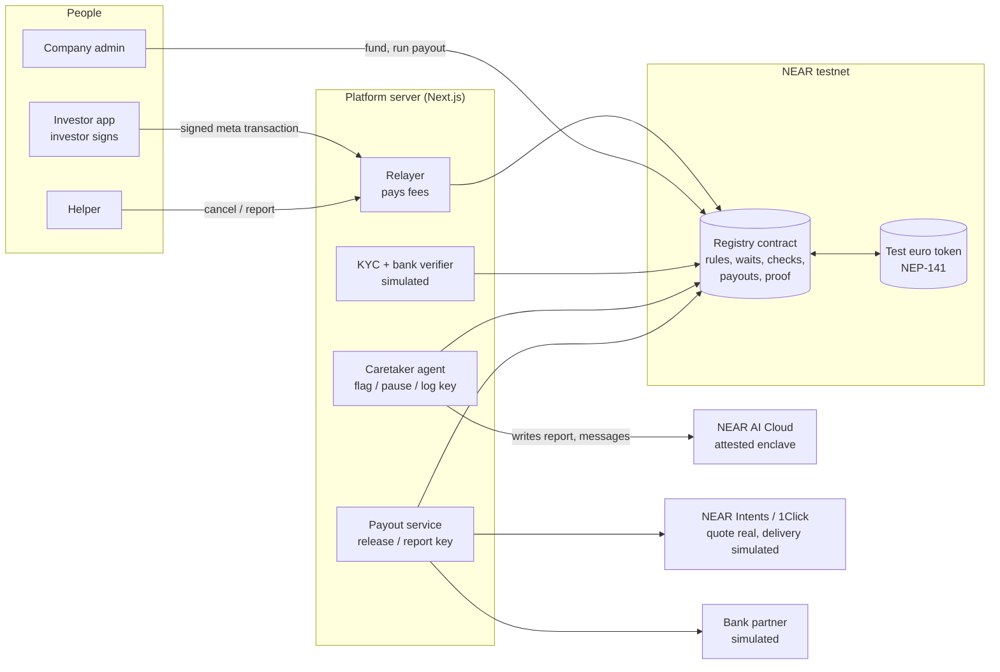

# Mnemon Payment Agent — simple, scam-resistant payout details for companies with many small shareholders

Built at NEAR HACKATHON (Nov 1–14, 2026). Tracks: `realworld`, `security`, `privacy`.

*In ancient Greek cities, the* mnemones *kept the official property records. Mnemon keeps every shareholder's record verified and current, then pays each one exactly their share. It does the payment agent's job: the contract moves the money, and the AI agent never can.*

## Check it in 10 minutes

From least to most setup:

| What | Needs | Do → see |
|---|---|---|
| 1. Watch the demo | A browser | [Demo video](VIDEO_LINK) (about 2½ minutes) → the whole exit day, end to end |
| 2. Verify the run on-chain | A browser (the `near` CLI for two optional reads) | [Verify it on-chain](#verify-it-on-chain-no-setup) → every step of a full testnet run as a real transaction, including the manifest root logged before any money moved |
| 3. Run the contract tests | Rust only | `cd contract && cargo test` → 87 tests pass: who may change what, waiting periods, holds, payout checks, the manifest proof |
| 4. Run the whole app | Node.js 24+ and a funded testnet account; Rust and a NEAR AI Cloud key are optional | [Run locally](#run-locally), then the 12 steps in [Try it](#try-it) |

Without a NEAR AI Cloud key the app still runs. The agent's on-chain actions and the network rejecting its key work the same. The enclave's attestation is still fetched and checked. Only the AI's own wording is replaced by plain templates, each run says so in the Agent log, and "Agent: read the documents" in the estate flow is unavailable.

## What it is

**An AI payment agent for exit day that keeps every shareholder verified and reachable, can't be tricked into moving money, and proves every payout matched each holder's shares, with holders known on-chain only as random accounts, never by name.**

A shareholder registry on NEAR where each investor's payout details are verified, kept current, and changeable only by the investor. It is designed for older, non-technical investors: a few large, plain-language screens, login with email or a text code, and no crypto terms. Companies use it to pay many small shareholders (for example, crowdfunding investors at an exit) without phone callbacks, without chasing bank details, and without losing track of investors.

**Built for a stablecoin-first future.** By default investors receive euros as a stablecoin in their own account in the app; anyone can choose another chain or token, paid through **NEAR Intents**; bank transfers through a licensed partner remain as today's bridge. Older investors simply see "€… received".

## Goals

1. **No more callbacks.** Shareholders keep their own details verified; companies never phone anyone to confirm a bank account.
2. **Better security.** No change takes effect without the shareholder's own strong identification, a waiting period and alerts. Nobody else, including the company and the platform operator, can change a shareholder's details.
3. **Provably correct payouts.** Every holder is paid exactly for their shares at the record date, and the totals reconcile to the smallest unit. A missed share transfer is caught before any money moves.
4. **Better investor experience.** Familiar identification, a few large plain-language screens, one update for every company, and payouts that simply arrive.

## Why we built this

Companies that raise money from hundreds of small investors often keep a shareholder register where investors log in and update their own details, but it holds no verified bank details and offers no way to pay shareholders. To pay investors at an exit, a company has to hire a payment agent, which shareholders often find complicated and hard to trust.

## The problem

- **No payout layer:** growth companies with many small shareholders have no simple, trusted way to pay dividends or exit proceeds.
- **Callbacks:** to avoid paying the wrong account, companies phone shareholders to confirm bank details. This is slow, costly and can itself be defeated.
- **Impersonation fraud:** a criminal pretends to be a shareholder and asks to change the bank account. Checking that an account matches a name does not stop this, because a criminal with stolen documents can open an account in the victim's name.
- **Coached scams:** older investors are phoned by someone posing as their bank or the company and talked into making the change themselves. A correct login does not help when the real person is being deceived.
- **Stale records:** shareholders move, change banks or die. Nobody checks whether details are still correct until a payout fails.

## Why not just a secure login?

A login answers "is this the right person at this moment?" This project adds what comes after the login.

| Risk | Login-only self-service register | This project |
|---|---|---|
| Fraudster without the shareholder's credentials | Blocked (with strong identification) | Blocked |
| Shareholder coached by a scammer | Change accepted immediately | Warning screen, waiting period, trusted helper can cancel |
| Phished or taken-over login | Attacker can change details at once | Waiting period and alerts to the existing contact details |
| Platform staff or systems change a record | Possible | Not possible; only the shareholder can request changes |
| Proof of who changed what, when | Internal logs, if any | Tamper-proof change history |
| Details still correct | Only if the shareholder remembers to update | Yearly one-tap check, bounce detection, successful payouts as evidence |
| Bank account belongs to the shareholder | Not verified | Verified when added |
| Paying shareholders | Not possible | Built in |

## How it works

1. An investor logs in with email or a text code and sets one payout destination used by every company they hold shares in.
2. To change it, they answer a safety question ("Has anyone asked you to change this?"), confirm the new account with their bank, and enter a code. Three screens.
3. Only the investor can request a change. The contract rejects requests from anyone else, including the company and the platform operator.
4. The change takes effect after a waiting period, longer for risky patterns (first-ever change, or phone/email changed recently). The investor and their **trusted helper** (e.g. a son or daughter) are alerted, and either of them can cancel.
5. Every investor is **KYC'd once** (identity, sanctions and PEP screening, tax residency) by a licensed partner, and that KYC is reused by every company they hold shares in and kept current. Only an attestation goes on-chain. Once a year the investor taps "Yes, all correct" (and re-identifies with strong identification when KYC is due). Each investor has a status: green (current), amber (getting stale or change pending), red (unreachable, too old, KYC expired or screening under review).
6. An AI **caretaker agent** keeps details current: it notices stale or bounced details, reminds investors by email, text or letter, explains things in plain language, and can pause or freeze a payout for checking. Before a payout it reconciles the register with the shareholders and reports who is ready. Its NEAR key only allows flagging, pausing, freezing and logging; it can never change payout details, set share counts or move money, and only a human can lift a freeze.
7. A company opens a payout event and the contract snapshots the holdings. Each investor confirms their share count; a different number opens a dispute. The agent proposes a correction, the company applies it, and every affected holder confirms again.
8. The company runs the payout in a stablecoin. The contract does all the arithmetic; no AI touches the amounts. Nobody is paid without valid KYC, clear screening and a confirmed share count. Green and amber investors are paid to their active account, or, if they chose another chain or token, through NEAR Intents. Anyone else's share is held in the contract until they return, confirm and claim. A failed or refunded Intents payout is held, never lost.
9. When a shareholder dies, the record is frozen and payouts are held. The agent guides the family through the estate documents, and after a human approves, the money goes to the estate.

## Provably correct payouts

Errors come from the inputs (a transfer never recorded, a stale register) far more than from the arithmetic, so people check the inputs and code checks the arithmetic.

`execute_payout` pays nothing unless every check passes:

1. The snapshot adds up to the company's total shares.
2. The funded amount equals the event total exactly.
3. No disputes are open. Unconfirmed holders don't block the payout, but their share is held.
4. Each amount = floor(total × shares ÷ total shares), in the token's smallest units.
5. In flight + queued + held + remainder = total, to the smallest unit, and that stays true as transfers finish.
6. The rounding remainder is recorded and held for the company, never lost.

**The proof:** before any money moves, the contract calculates a Merkle root of the manifest (holder, shares, amount) and publishes it. Each investor can check their own line against it. This proves the calculation was fixed and can't be altered later. It does not hide anything: share counts per random account are readable on-chain, so anyone can recompute the amounts. Privacy comes from those accounts never being linked to a name.

## Compliance: KYC kept current

- **Why it matters:** payment agents redo KYC on every investor for every payout. A register whose KYC is always current removes that cost and much of the company's risk, especially before an exit.
- **Who does it:** a licensed KYC partner (an obliged entity under anti-money-laundering law) identifies investors with strong identification, screens sanctions and politically exposed persons, and records tax residency. The platform orchestrates and keeps it current.
- **Payout gate:** expired KYC or screening under review → the share is held, never paid. Sanctions lists are re-screened continuously.
- **Reuse:** one KYC serves every company, relying on the partner's checks and with the investor's consent.
- **Crypto-ready:** the EU travel rule requires recipient information and, for larger transfers to self-held wallets, proof the wallet belongs to the recipient. The investor's signature on their registered payout route provides it.
- **On-chain:** only "KYC valid until" and a screening status; no personal data, documents or reasons.

## Privacy

- **No personal data on-chain:** no names, emails, phone numbers or bank numbers; only a bank-account fingerprint.
- **Unlinkable accounts:** investors get random account IDs, not readable names.
- **Neutral records:** the chain shows that a holder is paused, frozen or transferred, never why. A death is never recorded as a death.
- **Private AI:** the caretaker agent reads investors' messages and estate documents inside a NEAR AI Cloud enclave (Intel TDX + NVIDIA GPU TEE) with verifiable attestation; not even the operator sees them. Only hashes of its actions go on-chain.
- **The enclave protects privacy, not money:** moving funds depends only on signatures and contract rules.

**Still visible on-chain:** each random account's share count per company, payout transfers and amounts (roadmap: Confidential Intents), when a holder was paused, frozen or transferred, and each payout's manifest root and counts.

## How NEAR is used

| NEAR feature | Used for |
|---|---|
| NEAR accounts and transaction signatures | Every change is authenticated by the investor's own account instead of a phone call |
| Login (simulated) | Investors log in with email or a text code on a labelled mock login screen; their random NEAR testnet account is used invisibly. In production this would be NEAR Auth |
| Meta transactions (relayer) | Investors and helpers sign with their own key; a platform relayer submits the call and pays the network fee, so they never need NEAR. The agent pays its own small fees from its restricted key's allowance |
| Function-call access keys | Each role gets a key limited to its methods: the helper can only cancel a change or freeze the record, the AI agent can only flag, pause, freeze and log, the investor's phone key cannot touch anything else |
| Smart contract (Rust, `near-sdk-rs`) | Enforces who may change what, waiting periods, helper cancels, statuses and payout splitting, for everyone including the operator |
| NEP-141 fungible token | Stablecoin payouts (a test stablecoin on testnet) and funds held for unreachable investors |
| NEP-297 events | Alerts to investors and helpers |
| NEAR AI Cloud private inference | The caretaker agent's AI runs in a verifiable enclave, so sensitive messages and documents stay private |
| NEAR Intents (1Click API) | Pays each investor on the chain and token they choose; stretch: lets an acquirer fund a payout from any chain and token. Roadmap: Confidential Intents to keep payout amounts private |

## Verify it on-chain (no setup)

Every step of the exit-day demo was run on NEAR testnet on 2026-11-08 (demo copy `d13`). You can check each one in the block explorer without installing anything. Investors are random 64-character accounts; the names below are from the demo's off-chain records, not the chain.

Contract: [`reg-d13.sr-tom-n1a.testnet`](https://testnet.nearblocks.io/address/reg-d13.sr-tom-n1a.testnet) · test euro token: [`teur-d13.sr-tom-n1a.testnet`](https://testnet.nearblocks.io/address/teur-d13.sr-tom-n1a.testnet)

| Step | What to look for | Transaction |
|---|---|---|
| The agent pauses Tom (email bounced) | `pause_holder`, signed by the agent's restricted key | [HnanfrUP…](https://testnet.nearblocks.io/txns/HnanfrUPDMPikXBLArzztZ47aYxk2B6SZbqAdkF1pUPu) |
| The agent flags Peter and Lena (share counts don't match the register) | `flag_holder` | [G2LNqsnu…](https://testnet.nearblocks.io/txns/G2LNqsnutTWKLaw9D5JxGPo7y2sLUWq5iG3eVYUbXdce), [3DwCzphq…](https://testnet.nearblocks.io/txns/3DwCzphqwoFsvXt2GDJkgS43zDuazTWXNRQQDUfKywpW) |
| The agent logs its proposed correction (hash only) | `log_agent_action` | [5esvmFbu…](https://testnet.nearblocks.io/txns/5esvmFbuxYqJ1ZdspnFzisUvvwVdpjSGKhmUmmZXP9d2) |
| Peter re-identifies (simulated KYC provider) | `record_kyc`, signed by the KYC provider's key | [F6Z7D8An…](https://testnet.nearblocks.io/txns/F6Z7D8AnYbBmwP8EL3yhARMiGWLLLeLqP6u5ogoPBfXo) |
| The company applies the correction: 200 shares Peter → Lena | `resolve_dispute` | [Dr8HjWkf…](https://testnet.nearblocks.io/txns/Dr8HjWkfNZRmn8csEEg5JukmrxeeoLsAJ2Ax7vDouPjo) |
| Peter confirms 800, Lena confirms 1,200 | `confirm_holding`, submitted by the fee relayer as a meta transaction | [6RPaKDeR…](https://testnet.nearblocks.io/txns/6RPaKDeRDiYsdWrs7jThDqNbiphijVN8tqSogDNXSpP7), [ErxZA8YD…](https://testnet.nearblocks.io/txns/ErxZA8YDfGfpKwekSFJT8CX9KYHVXNvec6WdJxUwyApA) |
| A stranger tries to redirect Maria's payout | Fails: "only the holder can request a payout change" | [CKbux61o…](https://testnet.nearblocks.io/txns/CKbux61okFYZ634ZTE2nC6peuHWd6ETEcCtxiD58Jrqy) |
| The company admin tries the same | Fails with the same error | [6vwXH1yr…](https://testnet.nearblocks.io/txns/6vwXH1yr2DYPqSscZAPS3CEHaEWephY8PXgaQCaM6geW) |
| Maria requests a bank change | `request_payout_change`, relayed; her fee was paid by the platform | [8JxJTYXw…](https://testnet.nearblocks.io/txns/8JxJTYXwWyX6SgYDMft6jp6tq4ZGusQQZNJLjaMVoCbv) |
| Anna, her helper, cancels it | `cancel_payout_change`, signed by Anna's key | [HvVgr3gP…](https://testnet.nearblocks.io/txns/HvVgr3gPqPfWkwBPLqGXr6YEKdvaPDqRPbGzmHCK9GiS) |
| **Exit payout** | `execute_payout`: the `payout_manifest` event with root `ba0497f4…a6d6` is logged before the token transfers | [9YX8SYTb…](https://testnet.nearblocks.io/txns/9YX8SYTb3kmHsZntz2RRSKU2McUM1yA8FDGQXbVvSXBR) |
| Lena's Intents route: release, then report SUCCESS | `release_for_route`, `report_route_result` by the payout service. Delivery to Base is simulated; the 1Click quote was a real mainnet dry run | [BiwEG9zX…](https://testnet.nearblocks.io/txns/BiwEG9zXkA5TWoToeUHZJQcBJ74W2Byq2ey3g6PoqNaM), [FNpRcBka…](https://testnet.nearblocks.io/txns/FNpRcBkaz4TGsHTXPHyL4gPf7Lnnd1osL2GQcNbVi61r) |
| Tom comes back: confirms, then claims his held share | `confirm_details`, `confirm_holding`, `claim` | [FeuWZgka…](https://testnet.nearblocks.io/txns/FeuWZgkaUbQsRYoCR6EgKdUeEpKuRCf7wwVVLy4QV8cf), [Ctvr3uJx…](https://testnet.nearblocks.io/txns/Ctvr3uJx84XoKBBGk2AQsm5cU6ddSMBHt3bVzkoLnrTD), [E7ez7QHp…](https://testnet.nearblocks.io/txns/E7ez7QHpv3PJjEJ9KdxRpajCAJX7ytXpNKBCLqrJ1uMX) |
| The bank partner reports Maria's bank payment sent (simulated transfer) | `report_bank_sent`; the contract marks it paid | [3qZLtpK8…](https://testnet.nearblocks.io/txns/3qZLtpK8jZNqDd8U5BeCQpVvfLCBo6embu2kn3LNmpFU) |

**The agent being refused by the network has no transaction, by design.** When the agent's key tries `request_payout_change`, the RPC node refuses it with "Access key does not allow method request_payout_change" before it becomes a transaction. Check the key's limits yourself:

```bash
near account list-keys agent-d13.sr-tom-n1a.testnet network-config testnet now
# → one function-call key, receiver reg-d13.sr-tom-n1a.testnet,
#   methods: flag_holder, pause_holder, freeze_holder, log_agent_action
```

**The payout totals reconcile to the smallest unit.** No account is needed for this read:

```bash
near contract call-function as-read-only reg-d13.sr-tom-n1a.testnet get_payout \
  json-args '{"event_id":"acme-exit"}' network-config testnet now
# → event.state "executed", event.manifest_root "ba0497f4c14558d885577380d0db581069aaeeed724dd6ba426f1d9f69fca6d6",
#   totals: paid 25000000001 + remainder 2 = funded 25000000003 (6 decimals), queued 0, held 0, in_flight 0
```

Each investor can check their own line against the root: `get_manifest_proof` returns the proof, and `verify_manifest_line` checks it (in the app: **Check this payment**).

## Try it

Demo video: VIDEO_LINK (about 2½ minutes). There is no hosted copy: the demo shares one set of testnet accounts and a paid AI key, so it runs on your machine instead. See [Run locally](#run-locally); it takes a few minutes.

Everything happens on NEAR testnet with test tokens. The **Demo inbox** (bottom right on every page) shows the emails and texts that would be sent, and each new one pops up where you are, including login codes. Logins are a labelled mock: pick a person and the demo fills in the code from the text for you.

**First open Reset and click Reset demo** (about 2½ minutes). The demo clock is fast (details go stale after 10 minutes, a bank change waits 2–5 minutes) and the contract has no way to rewrite dates, so a reset puts a fresh copy of the contract on testnet and seeds the cast again. Run the exit payout between about **5 and 20 minutes after a reset**; the Reset page shows the window. Wait the same 5 minutes before Maria's bank change (step 7): until then the cast's own set-up is still in its waiting period, so the contract refuses a new change ("a change is already pending") and Anna is not yet Maria's helper. Steps 1–6 can start right away.

1. Open **Company** (Acme's dashboard). Acme has 25,000 shares: two VC funds (Larkspur Ventures, Quarry Hill Capital) and five individual investors with 1,000 each. → The exit payout of €25,000 is open and funded. Readiness: **4 of 7** ready; KYC current: 86%; the check "No share counts in dispute" is red.
2. Click **Run the caretaker agent**. → Its report (written by the model inside the NEAR AI Cloud enclave, attestation in the **Agent log**): Tom's email bounced, Peter's identity check expired, Peter says 800 shares and Lena says 1,200 where the register shows 1,000 each. It texts Tom and pauses his payouts, emails Peter and Lena (**Demo inbox**), and proposes one correction: an unrecorded transfer of 200 shares from Peter to Lena.
3. Open the **Investor app** as **Peter** and tap **Identify me again** (simulated). → His identity check is current.
4. On the dashboard, click **Apply correction**. → Peter shows 800 and Lena 1,200, both unconfirmed. In the investor app, Peter and Lena each confirm their new number. → Readiness: **6 of 7**, Tom held.
5. Open **Attacker**: **Redirect Maria's payout** (a stranger) and **Try as the company admin**. → Both refused by the contract: "only the holder can request a payout change", with explorer links.
6. Still on Attacker, **Send the fraud email** to the agent. → The AI says "refuse"; then the agent's own key is used to try the change anyway, and the NEAR network rejects it: that key may only flag, pause, freeze and log.
7. As **Maria (72)**, tap **Change my bank account** → **No, this is my own decision** → enter 4 digits → **Continue to my bank** (simulated) → the code. → Saved, but it takes 5 minutes instead of 2, because her phone number changed recently.
8. Log in as **Anna**, Maria's daughter and helper. → "Maria asked to change the bank account". Tap **Cancel this change**. → Maria's payouts still go to her usual account.
9. On the dashboard, the checks are green: click **Run exit payout**. → The contract publishes the manifest root, then pays: Peter and Erik receive test euros, Maria's bank payout is queued (simulated), Tom's share is held, and **Lena** is paid through NEAR Intents as USDC on Base (delivery simulated; a real 1Click quote is shown). Totals reconcile to the smallest unit, with a 2-unit rounding remainder kept for the company.
10. As Maria, tap **Check this payment**. → ✓ her amount matches her shares and her line verifies against the published manifest root.
11. As **Tom**, tap **Yes, all correct**, confirm his share count, then **Collect my money**. → His held share is paid.
12. On the dashboard, **Is everyone paid?** lists what is still needed per shareholder. Click **Bank partner: send bank payments (simulated)**. → Maria's bank payment is reported sent and the contract marks it paid. → **Everyone is paid**: €25,000.00 reached its shareholders, plus the rounding remainder kept for the company.

If someone is frozen (for example a helper reported a death by mistake), **Estate review** can lift the freeze or pass the money to the estate; the checklist links there.

Every investor action shows "No fee for you: the platform paid it": a relayer submits the investor's signed call as a meta transaction.

**Also built, not in the video:**

- **Honest bank change:** after a reset, make Maria's change as above and, as Anna, tap **That's fine**. After the wait, the new account is active.
- **Second company:** Maria and Peter also hold Bloom Foods shares. Their investor app lists both companies under one set of payout details: no second sign-up.
- **Estate flow**: after a reset (wait 5 minutes for Jonas's helper role to start), open the investor app as **Jonas**, Erik's son and helper, and tap **Tell us Erik has died**. → Erik's record is frozen; on the explorer the transaction says only `freeze_holder`, and the platform paid the fee. The agent emails Jonas the next steps (Demo inbox). Open **Estate review** and click **Agent: read the documents**. → The agent reads the simulated estate documents inside the NEAR AI Cloud enclave and prepares the case; code checks that the estate account matches. Run the exit payout (Erik's share is held), then, as the human reviewer, **Approve transfer to the estate** and **Estate: collect the money**. → Erik's held money goes to the estate's account. **Lift the freeze** undoes a mistaken report; only the reviewer's key can do either.

## What is real and what is simulated

| Real (NEAR testnet unless noted) | Simulated (labelled in the app) |
|---|---|
| Registry contract: who may change what, waiting periods, helper cancel, statuses, freeze and estate transfer | Login: a mock screen with a code in the Demo inbox; each person has a random testnet account whose key the demo site holds (in production: NEAR Auth on their phone) |
| Payout events, share-count confirmations and disputes, the payout checks, the manifest root and each investor's check | Emails and texts (shown in the Demo inbox) |
| Payouts in a test euro token, held funds and claims, the rounding remainder | Strong identification and the KYC provider (a platform service records the result with the KYC key) |
| Restricted keys per role; the network rejecting the agent's key | Bank account verification (a mock fingerprint) and the bank transfer itself: a simulated bank partner reports it sent, and the contract (real) then marks it paid |
| Meta transactions: a relayer pays investors' fees | NEAR Intents delivery: the payout service releases Lena's route and reports the result on testnet, but no USDC is sent. Its 1Click quote is real (a mainnet dry run, nothing sent) |
| The caretaker agent's model on NEAR AI Cloud, with attestation and signed replies checked | Estate documents |
| A second company (Bloom Foods) using the same verified details | The euro stablecoin: a test token (EURC or similar in production) |

## Security model

| Threat | Protection |
|---|---|
| Fraudster impersonates the investor | Only the investor's own login can request changes; the contract rejects anyone else |
| Investor is coached by a scammer | Warning screen, extended waiting period for risky patterns, helper alert and helper cancel; removing a helper also waits and alerts |
| Insider at the company or platform | Nobody but the investor can request changes; contract rules bind the operator too |
| Lost contact | Yearly one-tap check, bounce detection, caretaker agent outreach, held funds |
| Wrong share counts or an unrecorded transfer | Record-date snapshot, holder confirmations, agent cross-check, and checks that block the payout on any mismatch |
| Company shifts shares away from a silent holder | Corrections need an open dispute from the holder concerned; anyone unconfirmed is held, never paid on an unverified number |
| Rounding or arithmetic errors | Integer arithmetic in the contract, exact-total checks, remainder recorded; no AI in the calculation |
| A misbehaving or manipulated AI agent | Its function-call key only allows flag, pause, freeze and log; NEAR rejects anything else; only a human can lift a freeze; every action is logged |
| Fraud after a death | Record frozen on notice; money goes only to the estate after human review |
| Profiling from public chain data | Random unlinkable accounts, neutral method and event names, no reasons on-chain |
| Bank data exposure | Bank numbers never on-chain; in production verified inside a TEE and released only to the payment provider. Control of funds never depends on the TEE |

## Architecture



Only the investor's own key can change where their money goes. The platform's keys are function-call keys that NEAR limits to a few methods each, so the relayer can pay fees but not sign for anyone, and the agent can flag and pause but never move money.

- `contract/` — Rust smart contract: registry, rules, payout events, checks, manifest root, held funds, estate transfer (`cargo test` covers it)
- `token/` — test euro token (NEP-141) for testnet
- `frontend/` — Next.js app: investor app, helper view, company dashboard, agent log, demo inbox, attacker panel, estate review, reset
  - `src/server/agent/` — caretaker agent: plain code finds issues and proposals; the model on NEAR AI Cloud writes the report and messages; restricted key for contract calls
  - `src/server/nearai.ts` — NEAR AI Cloud calls, attestation and reply-signature checks
  - `src/server/near.ts` — NEAR calls, including `relayedCall` (meta transactions: the investor signs, the platform relayer pays)
  - `src/server/payout-service.ts` — Intents payout service (restricted key: release a registered route, report the result)
  - `src/server/estate.ts` — estate flow
  - `scripts/seed.mts`, `scripts/reset.mts` — deploy and seed a demo copy; recycle the old one
- `scripts/e2e-exit.sh` — full exit on testnet from the command line
- `DESIGN.md` — full design spec

## Run locally

Needs Node.js 24+ and a funded NEAR testnet account (about 10 test NEAR) with its key in `~/.near-credentials/testnet/`. Optional: a NEAR AI Cloud API key, so the agent's report and messages are written by the model in the enclave (generate it at [cloud.near.ai](https://cloud.near.ai); you can claim $10 of free credits by joining [NEAR Builders](https://nearbuilders.org/join)). Without it, see the note under [Check it in 10 minutes](#check-it-in-10-minutes).

```bash
cp .env.example .env            # optional: set NEAR_AI_API_KEY
cd frontend
npm install
node scripts/seed.mts d1 <your-account.testnet>   # deploys a demo copy (about 10 test NEAR, returned on reset)
npm run dev                                         # http://localhost:3000
```

**No Rust needed:** the built contracts are committed as `contract/res/shareholder_registry.wasm` and `token/res/test_euro.wasm`, and the seed script uses them. To build them yourself (Rust with `cargo-near`), run `cargo near build non-reproducible-wasm --no-abi` in `contract/` and in `token/`; a local build replaces the committed copy. These are non-reproducible builds (a reproducible build needs Docker), so your own build may not match them byte for byte. The committed files are the exact code running on the `d13` copy in [Verify it on-chain](#verify-it-on-chain-no-setup): their SHA-256 in base58 equals each account's on-chain `code_hash`.

| File | `code_hash` on testnet |
|---|---|
| `contract/res/shareholder_registry.wasm` | `Cua9jPgwf6Gxfszwdi9Q13y6rgDvQQe8vBLLc7gyb29F` (`reg-d13.sr-tom-n1a.testnet`) |
| `token/res/test_euro.wasm` | `7KHiMEJYALN14kJFpoYfVWvyhZ9qi3ypRzqSy8MYZm9V` (`teur-d13.sr-tom-n1a.testnet`) |

Contract tests: `cargo test` in `contract/`. Full exit on testnet with real token transfers: `bash scripts/e2e-exit.sh <suffix> <funded-testnet-account>`.

## Tests

87 contract tests (`cargo test` in `contract/`) cover, among others:
- a change requested by someone other than the holder is rejected
- a helper can cancel a pending change but cannot request one
- the waiting period is extended after a recent contact change or for a first-ever change
- a pending change does not receive payouts
- a bank change without a recent verification is rejected
- red investors' shares are held and claimable after confirmation
- a claim with expired KYC or screening under review is rejected
- confirming details lifts an agent pause but never a freeze
- a failed token transfer is recorded as held, not paid
- the agent's key can flag and pause but any other call is rejected
- a frozen holder's payouts are held, and only the estate reviewer can release them to a successor
- no method name or event reveals a reason (death, dispute) for freezing
- a holder with expired KYC or screening under review is held, not paid; only the KYC provider's key can record KYC
- an Intents route change follows the same signature, waiting-period and helper rules as any payout change
- a failed or refunded Intents payout is recorded as held, not paid
- a payout can't open unless holdings add up to total shares, and funding that isn't the exact total is refunded
- an open dispute blocks the payout; an unconfirmed holder's share is held
- a correction needs an open dispute from the holder concerned, keeps the total unchanged, updates the register, and requires re-confirmation
- amounts, remainder and totals reconcile to the smallest unit at every step, including when a transfer fails
- the manifest root is published before any money moves, and an investor's line verifies against it
- removing a helper waits and alerts; the helper can still cancel during that wait
- the agent and helpers can freeze but not unfreeze; only the reviewer can unfreeze
- the agent's key cannot set share counts

## Limitations

- The contract runs on testnet. NEAR Intents runs only on mainnet, so in the demo the Intents delivery is simulated (with a real 1Click quote). In production the payout service sends to the 1Click deposit address and polls its status; the contract side (release, report, hold on failure) is already real.
- An investor who never confirms their share count is held, not paid. That is the safe default, but in a real exit it means more follow-up.
- An open payout event can't be cancelled, and a correction can only involve holders already on the register.
- In the demo, an open dispute blocks the whole payout. Production could hold just the disputed share and pay everyone else.
- Payouts are processed in one transaction, suited to a demo of up to ~10 investors. Production needs batching.
- Login, bank verification, KYC checks, text messages, emails, bank payouts and the Intents delivery are simulated.
- The demo site holds the cast's testnet keys in place of their phones.

## Roadmap

1. Strong identification with national bank-based identification through a certified broker, for onboarding and for approving changes; EU Digital Identity Wallets for investors abroad when available.
2. KYC through a licensed partner: identity with strong identification, sanctions and PEP screening, tax residency, continuous re-screening; reused across companies with consent.
3. Real bank verification (open banking or bank-website proofs processed in a TEE; only a fingerprint stored).
4. Euro payouts to bank accounts through a licensed payment partner, so the platform itself never holds company or investor funds.
5. Dividend tax withholding and reporting, designed with a tax expert.
6. Real text, email and letter notifications with bounce detection; phone and paper channels for investors who don't use online banking.
7. Face ID / fingerprint signing and recovery through NEAR Auth.
8. Euro stablecoin (MiCA-compliant, e.g. EURC) as the default payout currency; Intents-funded exits from any chain; Confidential Intents to keep payout amounts private.
9. Always-on caretaker agent in an enclave (e.g. IronClaw on NEAR AI Cloud), and the bank verifier inside an attested enclave.
10. Registry state on NEAR's private shard once available.
11. Batched payouts for thousands of holders.
12. Integrations with crowdfunding platforms, so their portfolio companies can pay shareholders.

## Business model (short)

Companies or the platforms they use pay per payout (well below what a payment agent charges), for escrow handling through a licensed partner, and per KYC'd investor per year for keeping the register verified and current. Investors use it free. An investor verified once is ready for every company that pays them.

## Built with

All project code was written during the hackathon, from the first commit on 2026-11-01. There is no pre-hackathon code and no own earlier library, so nothing here is baseline.

- **Templates:** [`create-near-app`](https://github.com/near/create-near-app) for the website scaffold (Next.js), and `cargo near new` for the contract scaffold. The template's example auction contract was replaced by the registry contract.
- **Contract:** [near-sdk-rs](https://github.com/near/near-sdk-rs) 5.29, near-contract-standards 5.29 (the NEP-141 test euro token), [cargo-near](https://github.com/near/cargo-near).
- **App and platform services:** Next.js 16, React 19, TypeScript, [near-api-js](https://github.com/near/near-api-js) 7 (including meta transactions), [@noble/curves and @noble/hashes](https://github.com/paulmillr/noble-curves) (to check NEAR AI Cloud reply signatures), the Inter font.
- **External services:** [NEAR AI Cloud](https://cloud.near.ai) (model `z-ai/glm-5.3-flash`, running in a TEE), the [NEAR Intents 1Click API](https://docs.near-intents.org/) (dry-run quotes only), the FastNEAR testnet RPC, and [NearBlocks](https://testnet.nearblocks.io) for explorer links.
- **Tools:** [near-cli-rs](https://github.com/near/near-cli-rs).
- **AI-written code:** the code and docs were written with [Claude Code](https://claude.com/claude-code) (Anthropic). The human builder made the product and design decisions, reviewed the work and tested it.
- **Demo video:** recorded by a script driving the real app on testnet ([Playwright](https://playwright.dev) and Chrome); the waits are cut out and some footage is sped up. The voice-over is AI-generated (a Microsoft Edge neural voice, via [edge-tts](https://github.com/rany2/edge-tts)), and the video was assembled with [FFmpeg](https://ffmpeg.org).

## License

[MIT](LICENSE)
